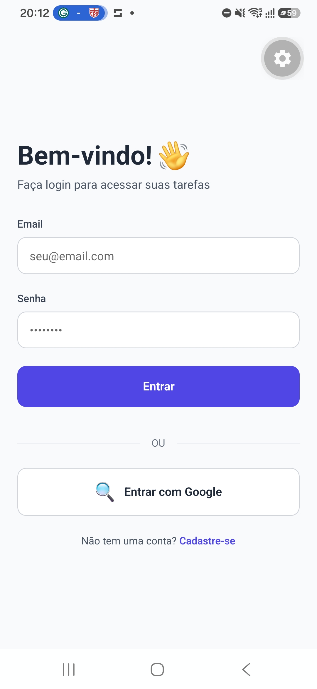
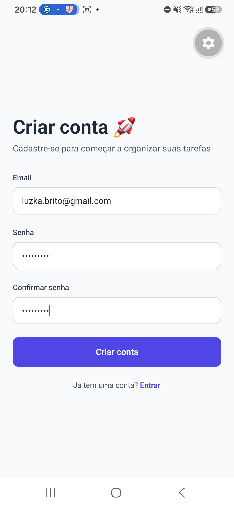
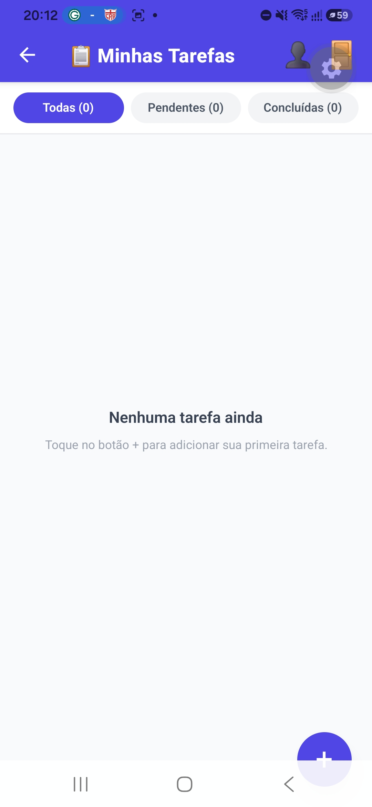
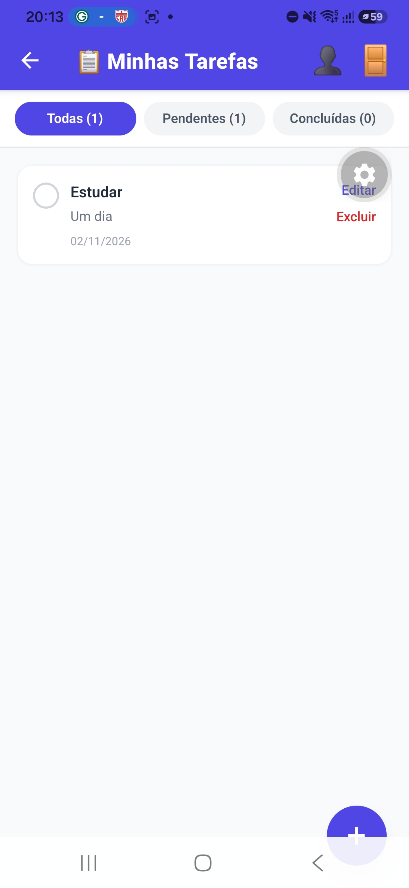
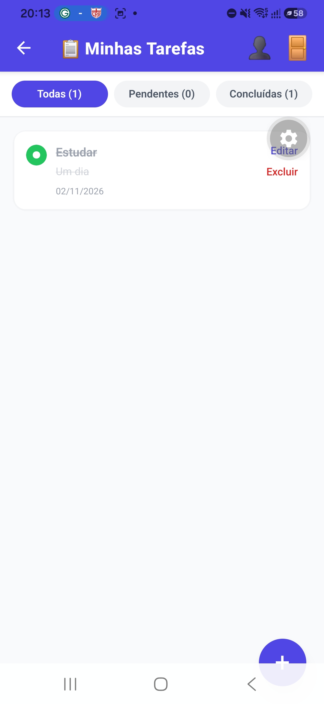
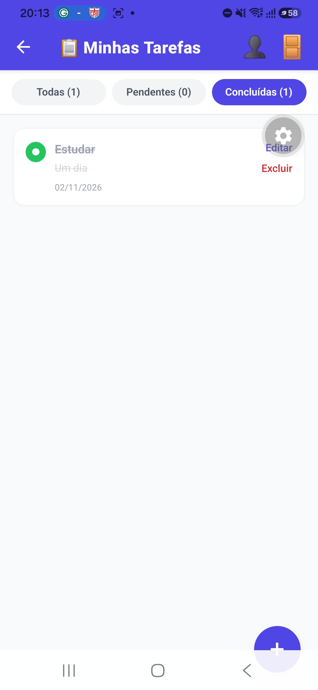
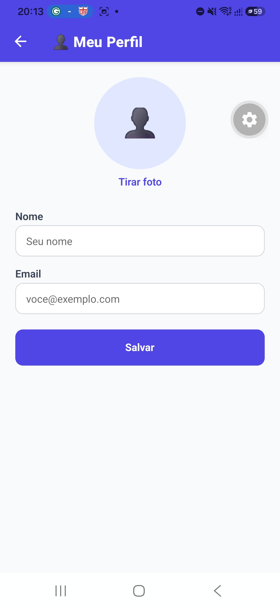

# 📱 Meu Lista de Tarefas

Projeto da disciplina de **Desenvolvimento para Dispositivos Móveis** da Fatec.

Aplicativo de lista de tarefas feito com **React Native, Expo e TypeScript**, com dados salvos no próprio celular (SQLite), perfil do usuário com foto tirada pela câmera e autenticação com **Firebase** (email/senha e Google).

✅ **Status do projeto:** desenvolvimento concluído até a **Etapa 30**.

## 📸 Capturas de tela

| Login | Cadastro | Lista vazia |
| --- | --- | --- |
|  |  |  |

| Tarefa pendente | Tarefa concluída | Filtro concluídas | Perfil |
| --- | --- | --- | --- |
|  |  |  |  |

## 🛠️ Tecnologias utilizadas

- React Native + Expo (SDK 57)
- TypeScript
- Expo Router (rotas baseadas em arquivos)
- NativeWind + Tailwind CSS
- Expo SQLite (banco de dados local)
- expo-camera e expo-file-system (foto de perfil)
- Firebase Authentication (email/senha e Google)
- expo-auth-session, expo-web-browser e expo-crypto (login com Google)
- AsyncStorage (mantém o login salvo ao fechar o app)

## ✨ Funcionalidades

- **Tarefas:** criar, editar, concluir e excluir, com filtros (todas, pendentes e concluídas).
- **Perfil:** nome, email e foto tirada com a câmera. A foto é copiada para o armazenamento permanente do app e continua lá depois de fechar e reabrir.
- **Autenticação:** cadastro, login com email e senha, login com Google e botão de sair.
- **Rotas protegidas:** quem não está logado só acessa as telas de login e cadastro.

## 📂 Estrutura do projeto

```
meu-lista-tarefas/
├── app/
│   ├── _layout.tsx        # layout e proteção de rotas
│   ├── index.tsx          # lista de tarefas
│   ├── form.tsx           # nova tarefa / editar tarefa
│   ├── profile.tsx        # perfil do usuário
│   ├── login.tsx          # tela de login
│   └── register.tsx       # tela de cadastro
├── src/
│   ├── types/             # task.ts, profile.ts, auth.ts
│   ├── database/          # database.ts, taskRepository.ts, profileRepository.ts
│   ├── hooks/             # useTasks.ts, useProfile.ts, useAuth.ts
│   ├── contexts/          # AuthContext.tsx
│   ├── services/          # firebaseConfig.ts
│   └── components/        # TaskItem, FilterBar, EmptyState, CameraCapture
├── assets/
├── docs/                  # capturas de tela usadas neste README
├── .env.example
├── global.css, tailwind.config.js, babel.config.js, metro.config.js
├── app.json
└── package.json
```

## 🧱 Arquitetura

O projeto separa as responsabilidades em camadas:

- **Telas (`app/`):** mostram os dados e recebem as ações do usuário, sem regra de negócio.
- **Hooks e contexto (`src/hooks`, `src/contexts`):** guardam o estado e a lógica de cada módulo.
- **Repositórios e serviços (`src/database`, `src/services`):** acessam o SQLite local ou o Firebase.

Os módulos de **tarefas** e **perfil** usam hooks isolados com SQLite. O módulo de **autenticação** usa Context API, porque todas as telas precisam saber se o usuário está logado.

## 🗄️ Banco de dados (SQLite)

Duas tabelas, criadas automaticamente na primeira execução (`runMigrations`):

- `tasks`: id, title, description, completed, createdAt (vários registros).
- `profile`: id, name, email, photoUri (registro único, id sempre 1). Guarda só o caminho da foto, não a imagem.

## 🚀 Como rodar

1. Instale o **Node.js 22.13 ou superior** e o app **Expo Go (SDK 57)** no celular.
2. Clone o repositório e instale as dependências:

```bash
git clone https://github.com/LucasBrito616/meu-lista-tarefas.git
cd meu-lista-tarefas
npm install --legacy-peer-deps
```

3. Crie o arquivo `.env` a partir do modelo e preencha com os dados do seu projeto Firebase:

```bash
cp .env.example .env
```

4. Inicie o servidor e escaneie o QR Code com o Expo Go (celular e computador na mesma rede Wi-Fi):

```bash
npx expo start --clear
```

Se o celular não conectar, use `npx expo start --tunnel`.

## 🔐 Configuração do Firebase

1. No [Firebase Console](https://console.firebase.google.com), crie um projeto e registre um app **Web** (`</>`).
2. Em **Authentication >